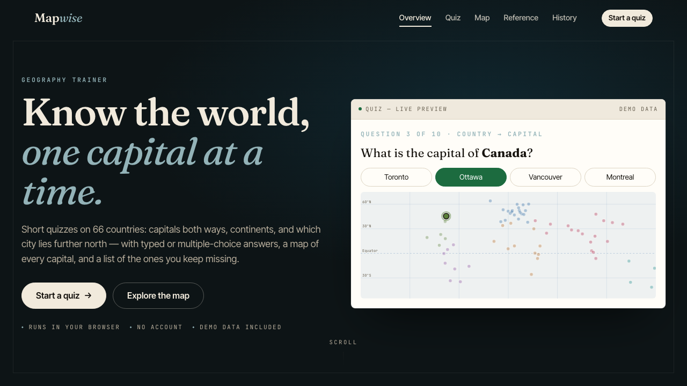
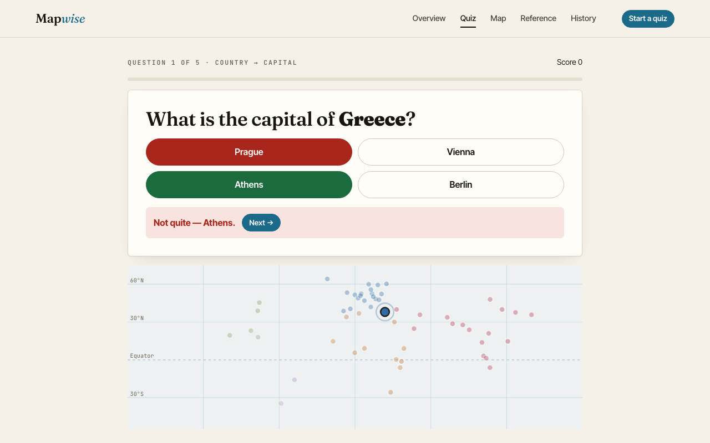
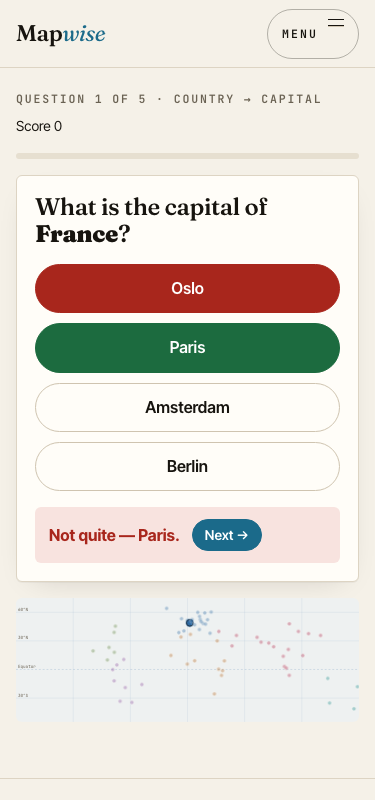

# Mapwise

A geography trainer for 66 countries: capitals both ways, continents and “which capital is further north”, with multiple-choice or typed answers, a dot map of every capital, a distance tool, a searchable reference and a history of scores and frequent misses.

**Live demo:** [https://mapwise-app.vercel.app/](https://mapwise-app.vercel.app/) — runs entirely in your browser; demo history is fictional and labelled.



| Quiz | Mobile |
| --- | --- |
|  |  |

## Run it

```bash
npm install
npm run dev        # http://localhost:5221
npm test
npm run build
npm run test:e2e   # Playwright smoke test (npm run e2e:install once if Chromium is missing)
```

## Main workflow

1. **Quiz** → choose a type (country → capital, capital → country, continent, further north), a continent and 5, 10 or 20 questions. For capital questions you can type instead of choosing.
2. Each answer shows whether it was right, the correct answer, any note (for countries with split capitals) and the capital(s) on the map.
3. The results page lists what to review and highlights those capitals; **Retry last round’s misses** builds a quiz from them.
4. **Map** → every capital as a dot coloured by continent; select one for details, and measure the great-circle distance between any two capitals.
5. **Reference** → sortable, searchable, paginated table of all countries; **History** → recent scores chart, average, best and the countries you miss most. The app opens with five labelled demo rounds.

## Rules

- Typed answers ignore case, accents, punctuation and a leading “the”, and accept common alternatives (USA, UK, Czech Republic, Washington DC, Ulan Bator).
- Countries with more than one capital accept each: South Africa (Pretoria, Cape Town, Bloemfontein) and Bolivia (Sucre, La Paz); notes explain the Netherlands and Tanzania.
- Multiple-choice distractors come from the same continent; “further north” pairs differ by at least 2° of latitude.
- Distances use the haversine formula on approximate capital coordinates (Earth radius 6,371 km).

## Design

Shared editorial system: Fraunces display type, Inter Tight interface text, mono coordinates, continent colours carried through the map, legend and reference table, an ink hero whose preview uses the real map, and a warm paper workspace. Dot and ping animations stop under `prefers-reduced-motion`.

## Tests

- `src/lib/geo.test.ts` — dataset integrity, hemispheres, answer normalisation and aliases, multiple capitals, distances, projection, seeded quizzes without repeats, distractors, north pairs, pool limits.
- `src/App.test.tsx` — a full multiple-choice round saved to history, typed answers with aliases, retrying misses, distance and map selection, reference and history pages.
- `e2e/smoke.spec.ts` — landing, a Europe round to results, distance tool, history with reload persistence, plus 375px layout checks.

## Limitations

- 66 countries, not all 190+; no flags, borders or coastlines (dots only).
- Coordinates are approximate to about 0.1°.

## Future improvements

- More countries and regions; a “click the map” mode with a drawn basemap.

## Licence

MIT — see [LICENSE](LICENSE).
